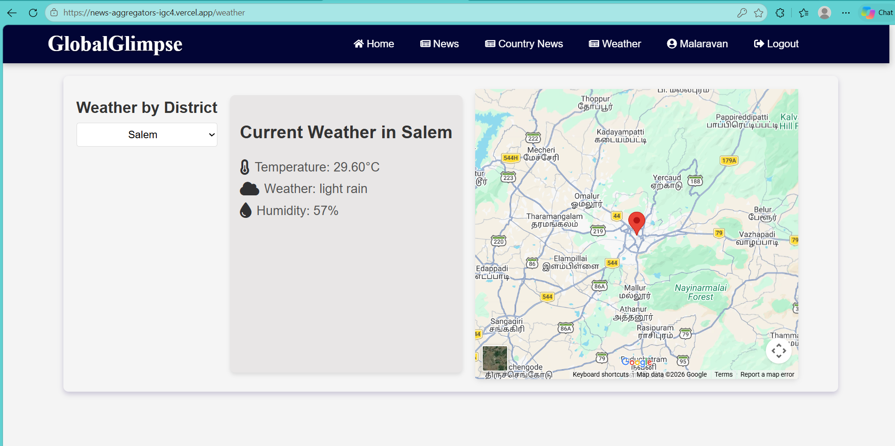

# 📰 News Aggregator – Real-Time News Platform

A Full Stack News Aggregator Web Application that brings the latest news from different categories and countries into one platform. Users can explore news, filter articles, browse country-specific updates, and check weather information through a user-friendly interface.

## 🚀 Features

- 📰 Latest News – Browse the latest news articles.
- 🌍 Country-Based News – Explore news from different countries.
- 🔍 News Filtering – Filter and discover relevant news.
- 🏠 Interactive Homepage – Clean and responsive news dashboard.
- 🔐 User Authentication – Sign Up and Sign In functionality.
- 🌦️ Weather Updates – Access weather information.
- 📱 Responsive UI – User-friendly interface across devices.

## 🛠️ Tech Stack

- **Backend:** Python, Django
- **Frontend:** HTML, CSS, JavaScript
- **Database:** MySQL
- **Database Hosting:** Aiven MySQL
- **Version Control:** Git & GitHub

## 📸 Screenshots

### 🏠 Home Page


### 🌍 Country News


### 🔍 Filter Page


### 📰 News Pages


### 🔐 Authentication


### 🌦️ Weather Page



## ⚙️ Installation & Setup

### 1. Clone Repository

```bash
git clone https://github.com/Malaravan236/News_Aggregators.git
```

### 2. Navigate to Project

```bash
cd News_Aggregators
```

### 3. Create Virtual Environment

```bash
python -m venv venv
```

### 4. Activate Virtual Environment

Windows:

```bash
venv\Scripts\activate
```

### 5. Install Dependencies

```bash
pip install -r requirements.txt
```

### 6. Apply Migrations

```bash
python manage.py migrate
```

### 7. Run Development Server

```bash
python manage.py runserver
```

Open your browser:

```text
http://127.0.0.1:8000/
```

## 👨‍💻 Developer

**Malaravan R**

Python Full Stack Developer

- GitHub: https://github.com/Malaravan236
- LinkedIn: https://www.linkedin.com/in/malaravanr/
- Email: malaravan236@gmail.com

---

⭐ If you find this project interesting, feel free to explore the repository and give it a star!
